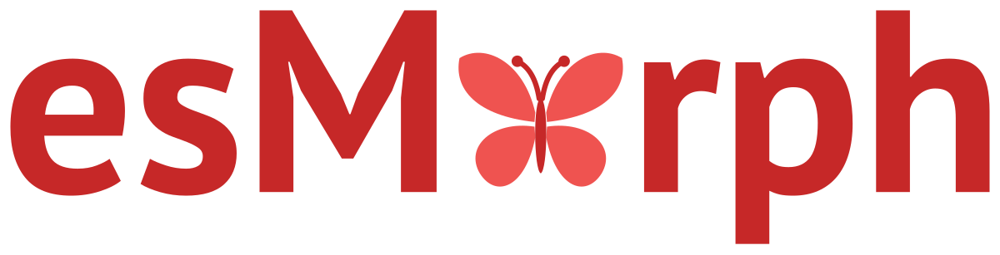

<p align="center">
  
</p>

<h1 align="center">esMorph</h1>

<p align="center">
  Analizador morfológico rápido del español escrito en Rust, con API para Python
</p>

<p align="center">
  <a href="https://sergeyshk.github.io/esMorph/es/">Documentación</a> ·
  <a href="https://pypi.org/project/esmorph/">PyPI</a> ·
  <a href="https://crates.io/crates/esmorph">crates.io</a> ·
  <a href="https://github.com/SergeyShk/esMorph/blob/master/README.md">English</a>
</p>

<p align="center">
  <a href="https://pypi.org/project/esmorph/"></a>
  <a href="https://pypi.org/project/esmorph/"></a>
  <a href="https://crates.io/crates/esmorph"></a>
  <a href="https://github.com/SergeyShk/esMorph/actions/workflows/ci.yml"></a>
  <a href="https://github.com/astral-sh/ruff"></a>
  <a href="https://github.com/SergeyShk/esMorph/blob/master/LICENSE.txt"></a>
</p>

---

**esMorph** es un analizador morfológico del español: un núcleo en Rust con API para Python. Para una forma de palabra busca los análisis en un diccionario creado a partir de [Wiktionary](https://en.wiktionary.org) - el lema, la categoría gramatical y los rasgos de [Universal Dependencies](https://universaldependencies.org/) -, los ordena por probabilidad y construye las formas de la palabra: conjugación, género y número.

Analiza 1.2 millones de tokens por segundo desde Python, 28 veces más rápido que spaCy, y lematiza tan rápido como simplemma, cuyos lemas aciertan menos en cada conjunto de prueba de UD. Las categorías, los rasgos y los lemas siguen la guía de UD y las convenciones del treebank AnCora, así que los resultados se pueden comparar con spaCy, Stanza y otras herramientas de UD.

* **[Analizador](https://sergeyshk.github.io/esMorph/es/analyzer/)** - los análisis de una forma de palabra por probabilidad, listas de palabras y lematización, comprobación de una forma de palabra en el diccionario
* **[Universal Dependencies](https://sergeyshk.github.io/esMorph/es/analysis/#ud)** - categorías, rasgos y lemas según la guía de UD y las convenciones de AnCora
* **[Verbos con clíticos](https://sergeyshk.github.io/esMorph/es/analysis/#clitics)** - un verbo con pronombres enclíticos y sus palabras: `dámelo` es `da` + `me` + `lo`
* **[Tokens fuera del diccionario](https://sergeyshk.github.io/esMorph/es/analysis/#rules)** - puntuación, números, ordinales, números romanos, nombres, direcciones y abreviaturas por reglas
* **[Palabras desconocidas](https://sergeyshk.github.io/esMorph/es/analysis/#guess)** - análisis por la terminación, un guion o un prefijo, y las formas de las palabras adivinadas
* **[Flexión](https://sergeyshk.github.io/esMorph/es/inflection/)** - las formas de un lexema y la forma con los rasgos de UD dados
* **[Comparación](https://sergeyshk.github.io/esMorph/es/comparison/)** - precisión, flexión y velocidad frente a simplemma, spaCy, Stanza, ablaut y verbecc

> [!NOTE]
> Versión temprana: hasta la 1.0 la API puede cambiar entre versiones 0.x; los cambios se describen en las notas de cada versión.

## Instalación

Se requiere Python 3.11 o superior.

```bash
pip install esmorph
```

O con [uv](https://docs.astral.sh/uv/):

```bash
uv add esmorph
```

Hay paquetes precompilados para Linux (también Alpine), macOS y Windows y para Python 3.14t sin GIL; para instalarlos no hace falta Rust, y el diccionario va en el paquete. En otras plataformas pip compila el paquete desde el código fuente, lo que requiere [Rust](https://www.rust-lang.org/tools/install) 1.88 o superior. Más detalles en la página de [instalación](https://sergeyshk.github.io/esMorph/es/installation/).

Para Rust está el crate [`esmorph`](https://crates.io/crates/esmorph) con el diccionario (`cargo add esmorph`; la documentación está en [docs.rs](https://docs.rs/esmorph)).

## Inicio rápido

```python
>>> from esmorph import Analyzer

>>> morph = Analyzer()
>>> morph.lemmatize("Los niños cantaban en la plaza".split())
['el', 'niño', 'cantar', 'en', 'el', 'plaza']
>>> analysis = morph.analyze("camiones")[0]
>>> analysis.lemma, analysis.pos, analysis.feats
('camión', 'NOUN', {'Gender': 'Masc', 'Number': 'Plur'})
>>> morph.analyze("hablar")[0].inflect(Tense="Past", Person="3", Number="Plur")
'hablaron'
>>> [form.word for form in morph.analyze("bonitas")[0].forms()]
['bonito', 'bonita', 'bonitos', 'bonitas']
```

El analizador se crea una vez: carga el diccionario, y luego se puede usar en todo el programa.

## Funciones

### Análisis de una forma de palabra

`analyze` da los análisis de una forma de palabra, primero el más probable: objetos `Analysis` con el lema, la categoría gramatical, los rasgos de UD, la probabilidad y el origen del análisis. Las mayúsculas no importan para buscar una palabra, aunque una palabra con mayúscula también puede ser un nombre, y una palabra sin sus tildes también se encuentra. Los análisis son inmutables: se pueden comparar, guardar en conjuntos y serializar con pickle.

```python
>>> [(a.lemma, a.pos, round(a.prob, 3)) for a in morph.analyze("canto")]
[('canto', 'NOUN', 0.999), ('cantar', 'VERB', 0.001)]
>>> analysis = morph.analyze("dámelo")[0]
>>> analysis.lemma, analysis.pos, analysis.words
('dar', 'VERB', ('da', 'me', 'lo'))
>>> morph.is_known("Camion"), morph.is_known("qzxw")
(True, False)
```

`analyze_many` analiza una lista de palabras, y `lemmatize` da sus lemas sin el GIL. El analizador y los análisis se serializan con pickle, así que funcionan con `multiprocessing` y joblib.

Más detalles en la documentación: [analizador](https://sergeyshk.github.io/esMorph/es/analyzer/), [análisis de palabras](https://sergeyshk.github.io/esMorph/es/analysis/).

<details>
<summary><b>Categorías y rasgos de Universal Dependencies</b></summary>

<br>

Las categorías, los rasgos y los lemas siguen la guía de [Universal Dependencies](https://universaldependencies.org/u/pos/) y, donde esta no dice nada, las convenciones del mayor treebank del español, [UD Spanish AnCora](https://github.com/UniversalDependencies/UD_Spanish-AnCora):

*   los determinantes, los pronombres, las preposiciones y las conjunciones tienen los lemas y los rasgos de AnCora: `la` es el artículo `el` o el pronombre `él`, `se` es `él` con `Reflex=Yes`, `su` es `DET` con `Poss=Yes`
*   `ser`, `estar`, `haber` y los demás auxiliares tienen análisis `AUX` y `VERB`
*   un participio es un verbo y un adjetivo, los verbos no tienen `-se` en el lema, un nombre propio tiene el lema con mayúscula

```python
>>> [(w, morph.analyze(w)[0].lemma, morph.analyze(w)[0].pos) for w in ["la", "su", "hay", "madrid"]]
[('la', 'el', 'DET'), ('su', 'su', 'DET'), ('hay', 'haber', 'VERB'), ('madrid', 'Madrid', 'PROPN')]
>>> morph.analyze("la")[0].feats
{'Definite': 'Def', 'Gender': 'Fem', 'Number': 'Sing', 'PronType': 'Art'}
```

Más detalles en la [documentación](https://sergeyshk.github.io/esMorph/es/analysis/#ud).

</details>

<details>
<summary><b>Tokens fuera del diccionario y palabras desconocidas</b></summary>

<br>

Los tokens que el diccionario no tiene reciben los análisis de unas reglas, con `source` igual a `"rule"`: la puntuación, los símbolos, los números con cifras, los ordinales (`2.ª`), los números romanos, los nombres, las direcciones y las abreviaturas. Una palabra en minúsculas que no conocen ni el diccionario ni las reglas se adivina, con `source` igual a `"guess"`: por su última parte tras un guion, por la palabra sin un prefijo conocido, como un verbo con clíticos o por las palabras del diccionario con su terminación. Una palabra adivinada también tiene sus formas.

```python
>>> [(a.lemma, a.pos, a.source) for w in ["2.ª", "10.000", "xii"] for a in morph.analyze(w)]
[('2.º', 'ADJ', 'rule'), ('10000', 'NUM', 'rule'), ('xii', 'NUM', 'rule')]
>>> [(morph.analyze(w)[0].lemma, morph.analyze(w)[0].source) for w in ["supergallos", "esbeltísima"]]
[('supergallo', 'guess'), ('esbeltísimo', 'guess')]
>>> morph.analyze("zumbeábamos")[0].inflect(Tense="Pres", Person="3", Number="Sing")
'zumbea'
```

Más detalles en la documentación: [tokens fuera del diccionario](https://sergeyshk.github.io/esMorph/es/analysis/#rules), [palabras desconocidas](https://sergeyshk.github.io/esMorph/es/analysis/#guess).

</details>

<details>
<summary><b>Flexión</b></summary>

<br>

`forms()` da las formas del lexema de un análisis en el orden de su paradigma, e `inflect` da la forma con los rasgos de UD dados y conserva los demás rasgos del análisis. Una variante, como una forma de `vos` o una grafía antigua, solo sale de una variante.

```python
>>> morph.analyze("gata")[0].inflect(Number="Plur")
'gatas'
>>> morph.analyze("hablás")[0].inflect(Mood="Imp")
'hablá'
```

Más detalles en la [documentación](https://sergeyshk.github.io/esMorph/es/inflection/).

</details>

<details>
<summary><b>Comparación</b></summary>

<br>

El porcentaje de palabras cuyo primer análisis tiene el lema correcto, y la categoría, los rasgos y el lema correctos a la vez (partes de prueba de los treebanks de UD 2.18), y la velocidad del análisis de un texto:

| Sistema | Lema, AnCora | Lema, PUD | Lema, COSER | Todo a la vez, PUD | Tokens por segundo |
| :------ | :----------- | :-------- | :---------- | :----------------- | :----------------- |
| esMorph | 97.80 | 97.74 | 94.49 | **87.90** | 1 228 661 |
| simplemma | 96.94 | 96.96 | 93.50 | - | **2 507 937** |
| spaCy es_core_news_sm | 98.66 | 96.69 | 93.39 | 83.59 | 44 100 |
| Stanza | **99.16** | **97.80** | **94.98** | 86.34 | 2694 |

esMorph analiza una palabra sin contexto, mientras que spaCy y Stanza eligen el análisis por la oración y están entrenados en AnCora, así que allí van por delante; en PUD, nuevo para todos, el primer análisis de esMorph acierta más a menudo los rasgos y el lema a la vez. Un análisis con la categoría y el lema correctos está entre los análisis de esMorph para el 96-99 % de las palabras. Da la forma de referencia del 99.65, el 93.29 y el 95.55 % de los verbos de AnCora, PUD y COSER, frente al 98.87, el 92.71 y el 93.61 % de ablaut. Un texto corto junto con la carga tarda 3.5 ms frente a 0.35-2.3 s, y cada proceso más con el mismo diccionario añade 3.6 MB de memoria. Medido en un Apple M3 Pro con Python 3.11.

Más detalles en la [documentación](https://sergeyshk.github.io/esMorph/es/comparison/): todas las métricas, la flexión de los verbos, la gráfica de la velocidad según el tamaño del texto, la memoria y cómo se midió.

</details>

## Desarrollo

El proyecto usa [uv](https://docs.astral.sh/uv/) para gestionar las dependencias, [maturin](https://www.maturin.rs/) para compilar el módulo de Rust y [ruff](https://docs.astral.sh/ruff/) para el análisis y el formato del código. Se requieren Python 3.11 o superior y Rust 1.88 o superior.

```bash
git clone https://github.com/SergeyShk/esMorph.git
cd esMorph

make deps        # crear el entorno, instalar las dependencias y compilar el módulo de Rust
make dictionary  # crear el diccionario a partir de la instantánea de Wiktionary y los recuentos de treebanks
make test        # ejecutar las pruebas de Python, los ejemplos de los docstrings (doctest) y las pruebas de Rust
make lint        # ruff, mypy, rustfmt y clippy
```

La lista completa de comandos está en `make help`. La documentación es bilingüe: las páginas en inglés `docs/*.md` con las páginas en español `docs/*.es.md` al lado; al editar una página, actualice las dos versiones.

Antes de enviar cambios, instale los hooks que ejecutan los linters al hacer commit y las pruebas al hacer push:

```bash
uv run pre-commit install
```

## Contribuir

Los informes de errores, las ideas y los pull requests son bienvenidos, en inglés o en español - las [issues](https://github.com/SergeyShk/esMorph/issues) están abiertas. El flujo de trabajo y las comprobaciones previas a un pull request están en [CONTRIBUTING.md](https://github.com/SergeyShk/esMorph/blob/master/CONTRIBUTING.md).

<details>
<summary><b>Estructura del proyecto</b></summary>

<br>

*   **crates/esmorph** - el núcleo del analizador en Rust
*   **crates/esmorph-build** - el constructor del diccionario
*   **crates/esmorph-dict-es** - el diccionario como crate
*   **crates/esmorph-py** - el módulo de Python `esmorph._esmorph`, compilado con PyO3
*   **python/esmorph** - el paquete de Python
*   **scripts** - la exportación de Wiktionary y de los recuentos de los treebanks, las convenciones del diccionario, la comprobación del paquete instalado antes de publicar y la comparación con otras herramientas
*   **data** - las tablas de clases cerradas según UD Spanish AnCora y de los símbolos de unidades
*   **docs** - la documentación de MkDocs en inglés y en español
*   **tests** - las pruebas del paquete de Python

</details>

## Autores

*   Sergey Shkarin (kouki.sergey@gmail.com)

## Licencia

El código se distribuye bajo la licencia [MIT](https://github.com/SergeyShk/esMorph/blob/master/LICENSE.txt). El diccionario se crea a partir de [Wiktionary](https://en.wiktionary.org) y de los treebanks [UD Spanish AnCora](https://github.com/UniversalDependencies/UD_Spanish-AnCora) y [UD Spanish GSD](https://github.com/UniversalDependencies/UD_Spanish-GSD), y se distribuye bajo la licencia [CC BY-SA 4.0](https://github.com/SergeyShk/esMorph/blob/master/LICENSE-DICTIONARY.txt).

## Cita

Si usa **esMorph** en investigación o en programas, cítelo con la siguiente entrada de BibTeX: así ayuda al desarrollo y al mantenimiento del proyecto. Los mismos metadatos están en [CITATION.cff](https://github.com/SergeyShk/esMorph/blob/master/CITATION.cff) - GitHub los muestra en «Cite this repository».

```bibtex
@software{esMorph,
  author = {Sergey Shkarin},
  title = {{esMorph, a fast morphological analyzer for Spanish}},
  year = 2026,
  url = {https://github.com/SergeyShk/esMorph}
}
```
