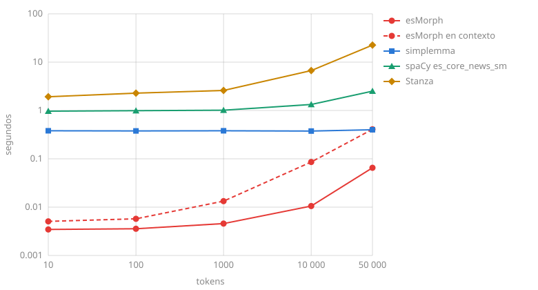

# Comparación

esMorph da todos los análisis de una palabra, primero el más probable, y los ordena según la oración con su modelo de contexto. En contexto su primer análisis tiene la categoría, los rasgos y el lema correctos a la vez para el 95.67 % de las palabras de AnCora, casi tan a menudo como spaCy `es_core_news_sm`, entrenado con él (95.92 %), y más a menudo que spaCy y Stanza en PUD y COSER, nuevos para todos ellos; su lema acierta más a menudo que el de cualquier otro sistema en AnCora y COSER. Sin contexto su primer lema acierta más a menudo que el de simplemma en los tres conjuntos de prueba de UD, y un análisis con la categoría y el lema correctos está entre sus análisis para el 96-99 % de las palabras. Conjuga los verbos con más precisión que ablaut y verbecc. Analiza 177 mil tokens por segundo en contexto, 3.5 veces más rápido que spaCy, y 1.9 millones sin él, responde a un texto corto junto con la carga en 3.0 ms, y cada proceso más con el mismo diccionario añade 3.6 MB de memoria.

## Calidad { #quality }

El estándar de referencia son las partes de prueba de los treebanks [UD Spanish AnCora](https://github.com/UniversalDependencies/UD_Spanish-AnCora), [GSD](https://github.com/UniversalDependencies/UD_Spanish-GSD), [PUD](https://github.com/UniversalDependencies/UD_Spanish-PUD) y [COSER](https://github.com/UniversalDependencies/UD_Spanish-COSER) de la versión UD 2.18: noticias, textos de la web, oraciones traducidas de Wikipedia y habla rural. Cada sistema recibe sus palabras de referencia, con `del` como `de` y `el` y un verbo aparte de sus clíticos, y esMorph en contexto recibe los tokens de una oración, un token multipalabra con sus palabras, como [`annotate`](analyzer.md#annotate) toma un documento; los signos de puntuación no se cuentan, y los lemas se comparan sin distinguir mayúsculas. Los lemas y los rasgos de GSD están asignados automáticamente, así que en él solo se compara la categoría gramatical. Los treebanks siguen convenciones distintas, así que hay que comparar los sistemas en un mismo conjunto, y no los conjuntos entre sí.

AnCora es el conjunto propio de los etiquetadores y de esMorph: spaCy `es_core_news_sm` está entrenado con AnCora, el modelo por defecto de Stanza con AnCora y GSD, y esMorph toma sus convenciones, las frecuencias de sus análisis y su modelo de contexto de las partes de entrenamiento de AnCora y GSD. PUD y COSER son nuevos para todos ellos.

### Lema { #lemma }

La proporción de palabras con el lema correcto, %; para esMorph, el lema del primer análisis, y para una palabra sin análisis, la palabra en minúsculas, como la da [`lemmatize`](analyzer.md#lemmatize), y en contexto, el lema del análisis que elige [`annotate`](analyzer.md#annotate):

| Sistema | AnCora | PUD | COSER |
| :------ | :----- | :-- | :---- |
| esMorph | 97.80 | 97.74 | 94.49 |
| esMorph en contexto | **99.29** | 97.71 | **95.66** |
| simplemma | 96.94 | 96.96 | 93.50 |
| spaCy es_core_news_sm | 98.66 | 96.69 | 93.39 |
| Stanza | 99.16 | **97.80** | 94.98 |

simplemma solo da un lema, de un diccionario sin categorías gramaticales.

### Categoría y rasgos { #tags }

Los etiquetadores y esMorph en contexto eligen el análisis según la oración; sin contexto el primer análisis de esMorph para una palabra como `que`, `la` o `como` es el más frecuente. En PUD el análisis sin contexto acierta un poco más a menudo que en contexto: el modelo de contexto aprende las convenciones de AnCora, y PUD etiqueta de otro modo las palabras de los nombres y los participios.

La proporción de palabras con la categoría gramatical correcta, con los rasgos correctos (género, número, persona, tiempo, modo, forma verbal; en los nombres propios y los numerales no se comparan, PUD les da género y número) y con todo junto con el lema, %; para esMorph, el primer análisis, y el oráculo: al menos uno de sus análisis tiene la categoría y el lema correctos:

=== "AnCora"

    | Sistema | Categoría | Rasgos | Todo junto | Oráculo |
    | :------ | :-------- | :----- | :--------- | :------ |
    | esMorph | 92.22 | 96.14 | 90.05 | 98.94 |
    | esMorph en contexto | 97.77 | 97.20 | 95.67 | - |
    | spaCy es_core_news_sm | 97.12 | 97.90 | 95.92 | - |
    | Stanza | **98.57** | **99.06** | **97.50** | - |

=== "PUD"

    | Sistema | Categoría | Rasgos | Todo junto | Oráculo |
    | :------ | :-------- | :----- | :--------- | :------ |
    | esMorph | 91.57 | **92.06** | **87.90** | 97.19 |
    | esMorph en contexto | 92.15 | 90.94 | 87.52 | - |
    | spaCy es_core_news_sm | 90.31 | 88.38 | 83.59 | - |
    | Stanza | **92.94** | 89.82 | 86.34 | - |

=== "COSER"

    | Sistema | Categoría | Rasgos | Todo junto | Oráculo |
    | :------ | :-------- | :----- | :--------- | :------ |
    | esMorph | 90.11 | 93.25 | 86.87 | 96.41 |
    | esMorph en contexto | 92.83 | **94.74** | **89.76** | - |
    | spaCy es_core_news_sm | 90.00 | 93.14 | 85.79 | - |
    | Stanza | **93.60** | 94.64 | 89.16 | - |

=== "GSD"

    | Sistema | Categoría |
    | :------ | :-------- |
    | esMorph | 92.43 |
    | esMorph en contexto | 92.58 |
    | spaCy es_core_news_sm | 90.29 |
    | Stanza | **93.39** |

### Flexión { #inflection }

La proporción de verbos cuya forma da el sistema a partir de su lema y sus rasgos de referencia (infinitivo, gerundio, participio, modo, tiempo, persona y número), %. Cada sistema recibe solo el lema y los rasgos: esMorph se evalúa por [`inflect`](inflection.md) de sus lexemas verbales y auxiliares del lema, una forma de cada uno; ablaut y verbecc, por cualquier forma de la casilla de su tabla de conjugación:

| Sistema | AnCora | PUD | COSER |
| :------ | :----- | :-- | :---- |
| esMorph | **99.65** | **93.29** | **95.55** |
| ablaut | 98.87 | 92.71 | 93.61 |
| verbecc | 95.37 | 92.91 | 93.53 |

En AnCora la mayoría de los fallos de ablaut y verbecc son la tercera persona del singular del presente de `haber`: ablaut da solo `ha` y verbecc solo `hay`, mientras que esMorph tiene las dos, `ha` del auxiliar y `hay` del verbo; verbecc además falla con `pasar`, `resultar` y `suceder`, que cuentan como fallos. En PUD la mayoría de los fallos de los tres son una convención: los auxiliares `ha` y `había` de los tiempos compuestos tienen `Tense=Past`; COSER tiene formas orales como `trabajao` y `tá`. Para el pretérito imperfecto de subjuntivo esMorph y ablaut dan la forma en `-ra` (`fuera`), así que una forma en `-se` (`fuese`) es un fallo para ellos.

## Velocidad { #speed }

### Análisis de un texto { #text }

El tiempo de análisis de un texto junto con la importación y la carga del sistema en un proceso nuevo, en segundos; ambos ejes en escala logarítmica:

En un texto corto casi todo el tiempo se va en la carga: esMorph responde en 3.0 ms y en 4.9 ms en contexto, simplemma en 0.33 s, spaCy en 0.81 s y Stanza en 1.7 s. En un texto largo decide la velocidad del análisis, en tokens por segundo sin la carga; más es mejor:

| Sistema | Tokens por segundo |
| :------ | :----------------- |
| simplemma, solo lemas | 2 455 730 |
| esMorph | 1 877 869 |
| esMorph en contexto | 177 200 |
| spaCy es_core_news_sm | 50 175 |
| Stanza | 3171 |

esMorph da todos los análisis de una palabra, con rasgos y probabilidades; su lematización sola es casi tan rápida como simplemma, véase [Operaciones](#operations). En una cadena de spaCy el [componente](spacy.md) analiza 112 817 tokens por segundo, y con las palabras de referencia su categoría, sus rasgos y su lema aciertan a la vez para el 95.61, el 87.51 y el 89.56 % de las palabras de AnCora, PUD y COSER.

### Operaciones { #operations }

Miles de palabras, análisis o tablas por segundo; más es mejor:

| Operación | esMorph | simplemma | ablaut | verbecc |
| :-------- | :------ | :-------- | :----- | :------ |
| Análisis de una forma de palabra: `analyze` en un bucle | 1005 | - | - | - |
| Análisis de una lista: `analyze_many` | 1718 | - | - | - |
| Análisis de oraciones en contexto: `analyze_sentence`, tokens | 157 | - | - | - |
| Lematización: `lemmatize`, `lemmatize(word, lang="es")` | 1941 | 2107 | - | - |
| Lematización en 4 hilos: `lemmatize` | 6541 | - | - | - |
| Forma de un sustantivo o un adjetivo: `inflect(Number="Plur")` | 1594 | - | - | - |
| Forma de un verbo: `inflect(Mood="Sub", Tense="Pres", Person="1", Number="Sing")` | 607 | - | - | - |
| Tabla de conjugación: `forms()`, `conjugate(lemma)` | 116 | - | 1.7 | 0.8 |

simplemma guarda sus respuestas en una caché: con la caché llena por una pasada anterior sobre las mismas palabras lematiza 4.7 millones de palabras por segundo. ablaut y verbecc construyen una forma solo como parte de la tabla entera. `lemmatize` libera el GIL, así que los hilos que comparten un analizador trabajan en paralelo.

## Carga y memoria { #memory }

| | esMorph | simplemma | spaCy es_core_news_sm | Stanza |
| :- | :------ | :-------- | :-------------------- | :----- |
| Importación y carga | 3.2 ms | 0.38 s | 0.95 s | 1.9 s |
| Aumento de la memoria del proceso | 10.1 MB | 131 MB | 305 MB | 578 MB |
| Cada proceso más | 3.6 MB | 129 MB | 359 MB | 1.6 GB |

El archivo del diccionario de esMorph se proyecta en memoria, así que los procesos de `multiprocessing` o joblib y los workers de un servidor web lo comparten: la mayor parte de los 10.1 MB del primer proceso es el diccionario, y cada proceso más añade solo sus propias tablas y análisis. El modelo de contexto se lee en el primer análisis de una oración: unos 2 ms y 4 MB más.

## Cómo se midió { #method }

- Calidad, flexión y análisis de un texto: el script [`scripts/compare.py`](https://github.com/SergeyShk/esMorph/blob/master/scripts/compare.py), `uv run scripts/compare.py target/compare --chart docs/img/speed.svg`. Instala los sistemas en un entorno aparte con las versiones de todos los paquetes fijadas en `scripts/compare.py.lock` (esMorph, la versión de ese archivo o un paquete con `uv run --with dist/esmorph-*.whl`, como para esta página), descarga las partes de prueba de los treebanks y el modelo de Stanza comprobando sus sumas de control antes de medir y analiza las palabras de referencia; esMorph en contexto anota un documento de los tokens de referencia, con las palabras de los tokens multipalabra y las oraciones de referencia, y spaCy con esmorph es `spacy.blank("es")` con solo el componente, un documento de las palabras de referencia por oración de referencia. Flexión: los 5939, 2893 y 1237 verbos de AnCora, PUD y COSER cuyo lema es un infinitivo, sin erratas ni palabras extranjeras.
- Versiones: Python 3.11, esMorph 0.3.0, simplemma 2.0.0, spaCy 3.8.16 con el modelo es_core_news_sm 3.8.0 sin el analizador sintáctico ni NER, Stanza 1.15.0 con el modelo por defecto en la CPU (torch 2.15.0), ablaut 0.11.0, verbecc 2.0.3 (el paquete no trae modelo y entrena uno en la primera ejecución, así que sus cifras varían hasta en 0.2 entre instalaciones). Ordenador: Apple M3 Pro, macOS 26, con otras aplicaciones abiertas (carga media de 3-8), así que las velocidades indican el orden de magnitud.
- Velocidad del análisis de un texto: los 53 622 tokens de la parte de prueba de AnCora con la puntuación; tokens por segundo, el mejor de dos análisis de la parte entera después de la carga; puntos del gráfico, la mejor de tres ejecuciones de la importación, la carga y el análisis de los primeros 10-50 000 tokens en un proceso nuevo. Solo se mide la llamada al sistema: esMorph, `analyze_many` de todas las palabras y en contexto `annotate` del documento; simplemma, `lemmatize` de cada palabra con la caché vacía; spaCy, `nlp.pipe` de las oraciones; Stanza, el texto entero. esMorph y simplemma trabajan en un hilo, spaCy y Stanza con su configuración por defecto.
- Operaciones: 47 288 palabras de la parte de prueba de AnCora sin la puntuación, para `analyze_sentence` sus 1721 oraciones de 52 454 tokens con la puntuación, un token multipalabra como un solo token; la mejor de tres pasadas en un hilo, salvo la fila con hilos; verbos, los lexemas de los 4634 verbos de referencia cuyo lema es un infinitivo (verbecc, los primeros 2000, una pasada). Carga y memoria: la importación, la creación del analizador y el primer análisis, el aumento de la memoria residente del proceso (`ps -o rss`), la mediana de seis ejecuciones (de siete para esMorph); cada proceso más, el aumento de la memoria que el proceso no comparte con otros (USS) en cada uno de cuatro procesos de `multiprocessing` que cargan el sistema y analizan 200 oraciones.
