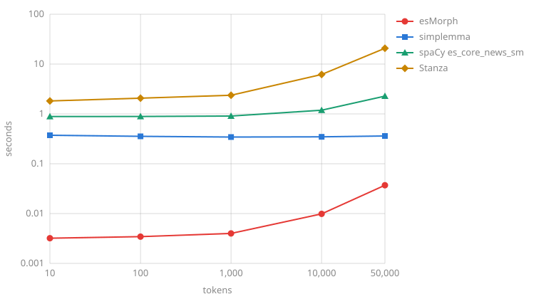

# Comparison

esMorph gives all the analyses of a word, the most probable first, and orders them by the sentence with its context model. In context its first analysis has the right part of speech, features and lemma all together for 95.67 % of the words of AnCora, almost as often as spaCy `es_core_news_sm` trained on it (95.92 %), and more often than spaCy and Stanza on PUD and COSER, new to all of them; its lemma is right more often than that of every other system on AnCora and COSER. Without context its first lemma is right more often than that of simplemma on all three UD test sets, and an analysis with the right part of speech and lemma is among its analyses for 96-99 % of words. It conjugates verbs more accurately than ablaut and verbecc. It analyzes 177 thousand tokens per second in context, 3.5 times faster than spaCy, and 1.9 million without, answers a short text together with loading in 3.0 ms, and every further process with the same dictionary adds 3.6 MB of memory.

## Quality { #quality }

The gold standard is the test parts of the [UD Spanish AnCora](https://github.com/UniversalDependencies/UD_Spanish-AnCora), [GSD](https://github.com/UniversalDependencies/UD_Spanish-GSD), [PUD](https://github.com/UniversalDependencies/UD_Spanish-PUD) and [COSER](https://github.com/UniversalDependencies/UD_Spanish-COSER) treebanks from the UD 2.18 release: news, web texts, translated Wikipedia sentences and rural speech. Every system gets their words, with `del` as `de` and `el` and a verb apart from its clitics, and esMorph in context gets the tokens of a sentence, a multiword token with its words, as [`annotate`](analyzer.md#annotate) takes a document; punctuation is not counted, and lemmas are compared ignoring case. The lemmas and features of GSD are assigned automatically, so only the part of speech is compared on it. The treebanks follow different conventions, so systems should be compared on the same set rather than sets against each other.

AnCora is the home set of the taggers and of esMorph: spaCy `es_core_news_sm` is trained on AnCora, the default Stanza model on AnCora and GSD, and esMorph takes its conventions, the frequencies of its analyses and its context model from the training parts of AnCora and GSD. PUD and COSER are new to all of them.

### Lemma { #lemma }

The share of words with the right lemma, %; for esMorph - the lemma of the first analysis, for a word without analyses - the word in lower case, as [`lemmatize`](analyzer.md#lemmatize) gives it, and in context - the lemma of the analysis that [`annotate`](analyzer.md#annotate) chooses:

| System | AnCora | PUD | COSER |
| :----- | :----- | :-- | :---- |
| esMorph | 97.80 | 97.74 | 94.49 |
| esMorph in context | **99.29** | 97.71 | **95.66** |
| simplemma | 96.94 | 96.96 | 93.50 |
| spaCy es_core_news_sm | 98.66 | 96.69 | 93.39 |
| Stanza | 99.16 | **97.80** | 94.98 |

simplemma gives only a lemma, from a dictionary without parts of speech.

### Part of speech and features { #tags }

Taggers and esMorph in context choose the analysis by the sentence; without context the first analysis of esMorph for a word such as `que`, `la` or `como` is the most frequent one. On PUD the analysis without context is right a little more often than in context: the context model learns the conventions of AnCora, and PUD tags the words of names and participles otherwise.

The share of words with the right part of speech, features (gender, number, person, tense, mood, verb form; for names and numerals they are not compared, PUD gives them a gender and a number) and all together with the lemma, %; for esMorph - the first analysis, and the oracle - at least one of its analyses has the right part of speech and lemma:

=== "AnCora"

    | System | Part of speech | Features | All together | Oracle |
    | :----- | :------------- | :------- | :----------- | :----- |
    | esMorph | 92.22 | 96.14 | 90.05 | 98.94 |
    | esMorph in context | 97.77 | 97.20 | 95.67 | - |
    | spaCy es_core_news_sm | 97.12 | 97.90 | 95.92 | - |
    | Stanza | **98.57** | **99.06** | **97.50** | - |

=== "PUD"

    | System | Part of speech | Features | All together | Oracle |
    | :----- | :------------- | :------- | :----------- | :----- |
    | esMorph | 91.57 | **92.06** | **87.90** | 97.19 |
    | esMorph in context | 92.15 | 90.94 | 87.52 | - |
    | spaCy es_core_news_sm | 90.31 | 88.38 | 83.59 | - |
    | Stanza | **92.94** | 89.82 | 86.34 | - |

=== "COSER"

    | System | Part of speech | Features | All together | Oracle |
    | :----- | :------------- | :------- | :----------- | :----- |
    | esMorph | 90.11 | 93.25 | 86.87 | 96.41 |
    | esMorph in context | 92.83 | **94.74** | **89.76** | - |
    | spaCy es_core_news_sm | 90.00 | 93.14 | 85.79 | - |
    | Stanza | **93.60** | 94.64 | 89.16 | - |

=== "GSD"

    | System | Part of speech |
    | :----- | :------------- |
    | esMorph | 92.43 |
    | esMorph in context | 92.58 |
    | spaCy es_core_news_sm | 90.29 |
    | Stanza | **93.39** |

### Inflection { #inflection }

The share of verbs whose form the system gives for their gold lemma and features (infinitive, gerund, participle, mood, tense, person and number), %. Every system gets only the lemma and the features: esMorph is scored by [`inflect`](inflection.md) of its verb and auxiliary lexemes of the lemma, one form of each, ablaut and verbecc by any form of the cell of their conjugation table:

| System | AnCora | PUD | COSER |
| :----- | :----- | :-- | :---- |
| esMorph | **99.65** | **93.29** | **95.55** |
| ablaut | 98.87 | 92.71 | 93.61 |
| verbecc | 95.37 | 92.91 | 93.53 |

On AnCora most misses of ablaut and verbecc are the third person singular of the present of `haber`: ablaut gives only `ha` and verbecc only `hay`, while esMorph has both, `ha` of the auxiliary and `hay` of the verb; verbecc also fails on `pasar`, `resultar` and `suceder`, which count as misses. On PUD most misses of all three are a convention: the auxiliaries `ha` and `había` of compound tenses have `Tense=Past`; COSER has spoken forms such as `trabajao` and `tá`. For the imperfect subjunctive esMorph and ablaut give the form in `-ra` (`fuera`), so a form in `-se` (`fuese`) is a miss for them.

## Speed { #speed }

### Text analysis { #text }

The time to analyze a text together with importing and loading the system in a new process, seconds, both axes on a logarithmic scale:

On a short text almost all the time goes to loading: esMorph answers in 3.0 ms and in 4.9 ms in context, simplemma in 0.33 s, spaCy in 0.81 s, Stanza in 1.7 s. On a long text the analysis speed decides, tokens per second without loading, more is better:

| System | Tokens per second |
| :----- | :---------------- |
| simplemma, lemmas only | 2,455,730 |
| esMorph | 1,877,869 |
| esMorph in context | 177,200 |
| spaCy es_core_news_sm | 50,175 |
| Stanza | 3,171 |

esMorph gives all the analyses of a word, with features and probabilities; its lemmatization alone is almost as fast as simplemma, see [Operations](#operations). In a spaCy pipeline the [component](spacy.md) analyzes 112,817 tokens per second, and on the gold words its part of speech, features and lemma are right together for 95.61, 87.51 and 89.56 % of the words of AnCora, PUD and COSER.

### Operations { #operations }

Thousands of words, analyses or tables per second, more is better:

| Operation | esMorph | simplemma | ablaut | verbecc |
| :-------- | :------ | :-------- | :----- | :------ |
| Analysis of a word form: `analyze` in a loop | 1,005 | - | - | - |
| Analysis of a list: `analyze_many` | 1,718 | - | - | - |
| Analysis of sentences in context: `analyze_sentence`, tokens | 157 | - | - | - |
| Lemmatization: `lemmatize`, `lemmatize(word, lang="es")` | 1,941 | 2,107 | - | - |
| Lemmatization in 4 threads: `lemmatize` | 6,541 | - | - | - |
| Form of a noun or an adjective: `inflect(Number="Plur")` | 1,594 | - | - | - |
| Form of a verb: `inflect(Mood="Sub", Tense="Pres", Person="1", Number="Sing")` | 607 | - | - | - |
| Conjugation table: `forms()`, `conjugate(lemma)` | 116 | - | 1.7 | 0.8 |

simplemma keeps its answers in a cache: with the cache filled by an earlier run over the same words it lemmatizes 4.7 million words per second. ablaut and verbecc build a form only as part of the whole table. `lemmatize` releases the GIL, so threads sharing one analyzer run in parallel.

## Loading and memory { #memory }

| | esMorph | simplemma | spaCy es_core_news_sm | Stanza |
| :- | :------ | :-------- | :-------------------- | :----- |
| Import and loading | 3.2 ms | 0.38 s | 0.95 s | 1.9 s |
| Growth of process memory | 10.1 MB | 131 MB | 305 MB | 578 MB |
| Every further process | 3.6 MB | 129 MB | 359 MB | 1.6 GB |

The dictionary file of esMorph is mapped into memory, so `multiprocessing` or joblib processes and web server workers share it: most of the 10.1 MB of the first process is the dictionary, and every further process adds only its own tables and analyses. The context model is read on the first analysis of a sentence: about 2 ms and 4 MB more.

## How it was measured { #method }

- Quality, inflection and text analysis - the [`scripts/compare.py`](https://github.com/SergeyShk/esMorph/blob/master/scripts/compare.py) script: `uv run scripts/compare.py target/compare --chart docs/img/speed.svg`. It installs the systems into a separate environment with the versions of all packages pinned in `scripts/compare.py.lock` (esMorph - the version from it, or a wheel with `uv run --with dist/esmorph-*.whl`, as for this page), downloads the treebank test parts and the Stanza model with checksum verification before measuring and analyzes the gold words; esMorph in context annotates a document of the gold tokens, with the words of the multiword tokens and the gold sentences, and spaCy with esmorph is `spacy.blank("es")` with the component alone, a document of the gold words per gold sentence. Inflection - the 5,939, 2,893 and 1,237 verbs of AnCora, PUD and COSER whose lemma is an infinitive, without typos and foreign words.
- Versions: Python 3.11, esMorph 0.3.0, simplemma 2.0.0, spaCy 3.8.16 with the es_core_news_sm 3.8.0 model without the parser and NER, Stanza 1.15.0 with the default model on the CPU (torch 2.15.0), ablaut 0.11.0, verbecc 2.0.3 (the package has no model and trains one at the first run, so its figures vary by up to 0.2 between installations). Computer - Apple M3 Pro, macOS 26, with other applications running (load average 3-8), so the speeds are an order of magnitude.
- Text analysis speed - the 53,622 tokens of the AnCora test part with punctuation: tokens per second - the best of two analyses of the whole part after loading, chart points - the best of three runs of importing, loading and analyzing the first 10-50,000 tokens in a new process. Only the call of the system is measured: esMorph `analyze_many` of all the words and in context `annotate` of the document, simplemma `lemmatize` of each word with an empty cache, spaCy `nlp.pipe` of the sentences, Stanza the whole text; esMorph and simplemma run in one thread, spaCy and Stanza with their default settings.
- Operations - 47,288 words of the AnCora test part without punctuation, for `analyze_sentence` its 1,721 sentences of 52,454 tokens with punctuation, a multiword token as one token; the best of three runs in one thread, except the row with threads; verbs - the lexemes of the 4,634 gold verbs whose lemma is an infinitive (verbecc - the first 2,000, one run). Loading and memory - importing, creating the analyzer and the first analysis, the growth of the resident memory of the process (`ps -o rss`), the median of six runs (of seven for esMorph); a further process - the growth of the memory the process does not share with others (USS), in each of four `multiprocessing` processes that load the system and analyze 200 sentences.
