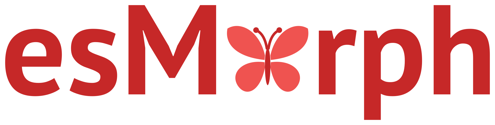

# esMorph



**esMorph** es un analizador morfológico del español: un núcleo en Rust con API para Python. Para una forma de palabra el analizador busca sus análisis en un diccionario creado a partir de Wiktionary - el lema, la categoría gramatical y los rasgos de [Universal Dependencies](https://universaldependencies.org/) -, los ordena por probabilidad y construye las formas de la palabra: conjugación, género y número.

!!! note "Versión temprana"
    Hasta la 1.0 la API puede cambiar entre versiones 0.x; los cambios se describen en las notas de cada versión.

## Funciones

<div class="grid cards" markdown>

-   :material-magnify:{ .lg .middle } __Análisis__

    ---

    Lema, categoría y rasgos de UD, probabilidad del análisis; listas de palabras, lematización y documentos del segmentador anySeg sin el GIL

    [:octicons-arrow-right-24: Analizador](analyzer.md)

-   :material-tag-text-outline:{ .lg .middle } __Universal Dependencies__

    ---

    Categorías, rasgos y lemas según las directrices de UD y las convenciones de AnCora; verbos con clíticos, números, signos y nombres por reglas, palabras desconocidas por su terminación

    [:octicons-arrow-right-24: Análisis de palabras](analysis.md)

-   :material-format-letter-case:{ .lg .middle } __Flexión__

    ---

    Formas del lexema y la forma según rasgos de UD: conjugación, género y número

    [:octicons-arrow-right-24: Flexión](inflection.md)

-   :material-speedometer:{ .lg .middle } __Comparación__

    ---

    Precisión, flexión y velocidad frente a simplemma, spaCy, Stanza, ablaut y verbecc, carga y memoria

    [:octicons-arrow-right-24: Comparación](comparison.md)

-   :material-alert-circle-outline:{ .lg .middle } __Excepciones__

    ---

    Excepciones integradas de Python y `FormNotFoundError` para las formas que faltan

    [:octicons-arrow-right-24: Excepciones](exceptions.md)

</div>

## Instalación

Se requiere Python 3.11 o superior.

``` bash
pip install esmorph
```

Los paquetes precompilados, la compilación desde el código fuente y el crate de Rust se describen en la página de [instalación](installation.md).

## Inicio rápido

=== "Código"

    ``` python
    from esmorph import Analyzer

    morph = Analyzer()
    morph.lemmatize(["Los", "niños", "cantaban", "canciones"])
    [(a.lemma, a.pos, round(a.prob, 3)) for a in morph.analyze("casa")][:2]
    morph.analyze("gatos")[0].inflect(Gender="Fem")
    morph.analyze("hablar")[0].inflect(Tense="Past", Person="3", Number="Plur")
    ```

=== "Resultado"

    ```
    ['el', 'niño', 'cantar', 'canción']
    [('casa', 'NOUN', 0.986), ('casar', 'VERB', 0.013)]
    'gatas'
    'hablaron'
    ```

??? note "Estructura del proyecto"

    *   **crates/esmorph** - el núcleo del analizador en Rust: formato del diccionario, construcción, análisis, reglas, estimación y flexión
    *   **crates/esmorph-build** - la construcción del diccionario a partir de la exportación de Wiktionary y los recuentos de los treebanks
    *   **crates/esmorph-dict-es** - el crate con el diccionario para `esmorph` en crates.io
    *   **crates/esmorph-py** - el módulo de Python `esmorph._esmorph` sobre PyO3
    *   **python/esmorph** - el paquete de Python
    *   **scripts** - la exportación de Wiktionary y de los recuentos de los treebanks, las convenciones del diccionario, la comprobación del paquete instalado antes de publicar y la comparación con otras herramientas
    *   **data** - las tablas de clases cerradas según UD Spanish AnCora y de los símbolos de unidades
    *   **docs** - documentación de MkDocs en inglés y español
    *   **tests** - pruebas del paquete de Python
