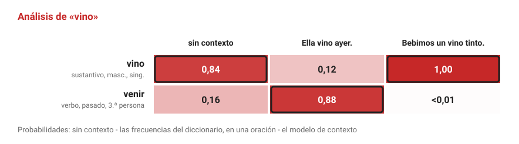
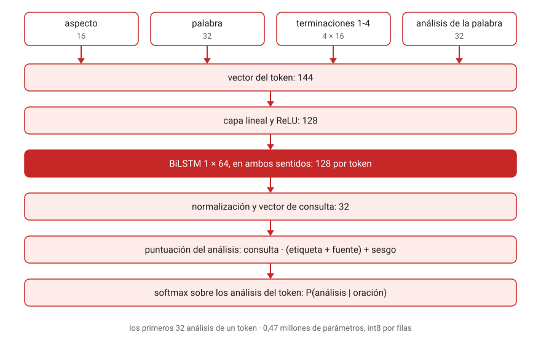
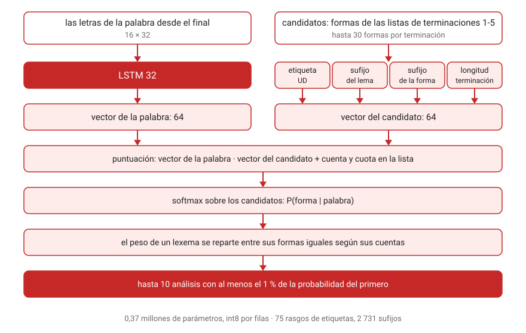
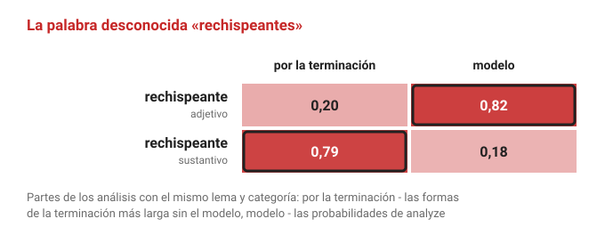

# Modelos

esMorph busca los análisis de una palabra en su diccionario y usa dos pequeñas redes neuronales: el modelo de contexto elige el análisis de una palabra según su oración, y el modelo de paradigmas estima los análisis de una palabra que el diccionario no tiene. Los dos funcionan en el núcleo de Rust sin otras bibliotecas, y sus pesos son secciones del archivo del diccionario.

## Modelo de contexto { #context }

Una palabra como `vino` es un sustantivo o un verbo, `la` un artículo o un pronombre, `como` una conjunción o un verbo. Sin contexto el diccionario ordena los análisis de una palabra según la frecuencia con que los tienen los treebanks UD Spanish AnCora y GSD; [`analyze_sentence`](analyzer.md#analyze_sentence), [`annotate`](analyzer.md#annotate) y el [comando](cli.md) los ordenan según la oración:

Para cada token el modelo lee su aspecto (mayúsculas, cifras, el comienzo de la oración), la palabra, sus terminaciones y los análisis que le da el diccionario; una LSTM bidireccional lee los tokens de la oración en ambos sentidos, y cada análisis de un token recibe una puntuación según el vector de su token, sus etiquetas y su fuente. Las probabilidades de los análisis de un token son el softmax de las puntuaciones. Después, unas pocas reglas del español ponen primero otro análisis donde solo él cabe ([`analyze_sentence`](analyzer.md#analyze_sentence)).

El modelo aprendió con las partes de entrenamiento de AnCora (todos los rasgos y el lema) y de GSD (solo la categoría, llevada a las convenciones de AnCora), y la época se eligió en la parte de desarrollo de AnCora.

## Modelo de paradigmas { #paradigm }

Una palabra en minúsculas que el diccionario no tiene se [estima](analysis.md#guess) por las palabras del diccionario con las mismas terminaciones: sus formas y tablas de flexión son sus candidatos. El modelo lee las letras de la palabra desde el final y puntúa cada candidato según su etiqueta, los sufijos de su lema y de su forma, la longitud de su terminación y cuántas palabras del diccionario la tienen. Aprendió de las palabras del propio diccionario, cada una estimada como si el diccionario no la tuviera, y prefiere los rasgos que los treebanks tienen con más frecuencia.

La frecuencia de una terminación por sí sola prefiere lo que son la mayoría de las palabras con ella; el modelo lee también el resto de la palabra:

## Licencia { #license }

Los pesos del modelo de contexto derivan de UD Spanish AnCora (CC BY 4.0) y UD Spanish GSD (CC BY-SA 4.0), y los del modelo de paradigmas del diccionario (CC BY-SA 4.0); se distribuyen con el diccionario bajo la licencia [CC BY-SA 4.0](https://creativecommons.org/licenses/by-sa/4.0/).
