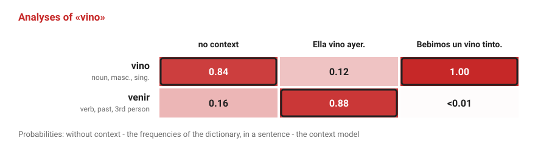
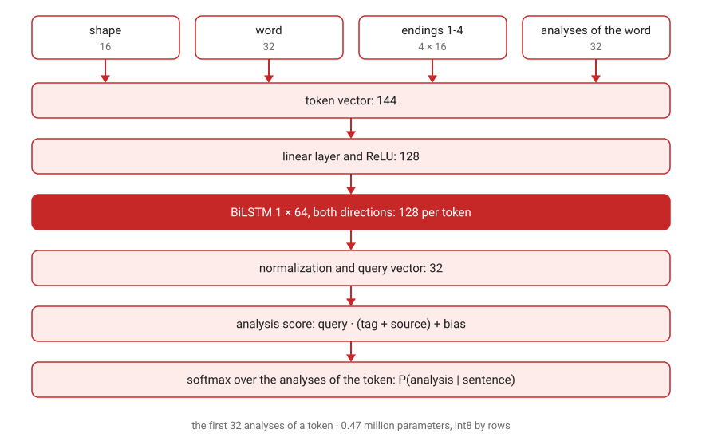
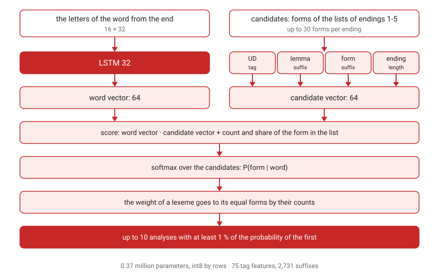
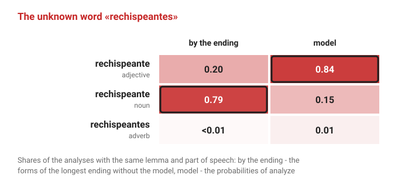

# Models

esMorph finds the analyses of a word in its dictionary and uses two small neural networks: the context model chooses the analysis of a word by its sentence, and the paradigm model guesses the analyses of a word that the dictionary does not have. Both run in the Rust core without other libraries, and their weights are sections of the dictionary file.

## Context model { #context }

A word such as `vino` is a noun or a verb, `la` an article or a pronoun, `como` a conjunction or a verb. Without context the dictionary orders the analyses of a word by how often the treebanks UD Spanish AnCora and GSD have them; [`analyze_sentence`](analyzer.md#analyze_sentence), [`annotate`](analyzer.md#annotate) and the [command](cli.md) order them by the sentence:

For every token the model reads its shape (case, digits, the start of the sentence), the word, its endings and the analyses the dictionary gives it; a bidirectional LSTM reads the tokens of the sentence in both directions, and every analysis of a token gets a score by the vector of its token, its tags and its source. The probabilities of the analyses of a token are the softmax of the scores. A few rules of Spanish then put another analysis first where only it fits ([`analyze_sentence`](analyzer.md#analyze_sentence)).

The model learned on the training parts of AnCora (all the features and the lemma) and GSD (only the part of speech, brought to the conventions of AnCora), and the epoch was chosen on the development part of AnCora.

## Paradigm model { #paradigm }

A lowercase word that the dictionary does not have is [guessed](analysis.md#guess) by the words of the dictionary with the same endings: their forms and inflection tables are its candidates. The model reads the letters of the word from its end and scores every candidate by its tag, the suffixes of its lemma and of its form, the length of its ending and how many words of the dictionary have it. It learned from the words of the dictionary itself, each guessed as if the dictionary did not have it, and prefers the features that the treebanks have more often.

The frequency of an ending alone prefers what most words with it are; the model also reads the rest of the word:

## License { #license }

The weights of the context model are derived from UD Spanish AnCora (CC BY 4.0) and UD Spanish GSD (CC BY-SA 4.0), and those of the paradigm model from the dictionary (CC BY-SA 4.0); they are distributed with the dictionary under the [CC BY-SA 4.0](https://creativecommons.org/licenses/by-sa/4.0/) license.
